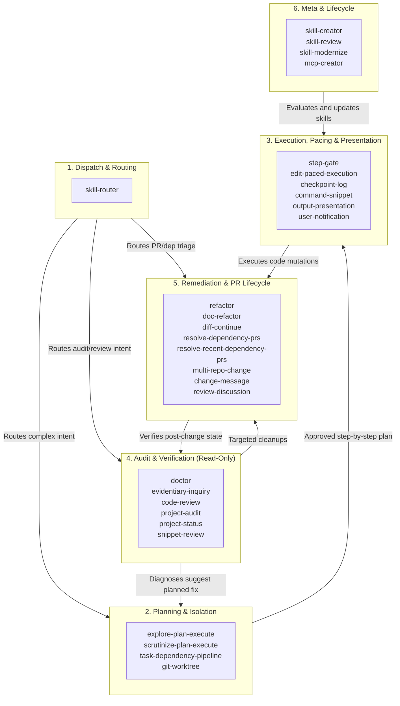

# AGENTS.md

Operational guidelines and conventions for AI agents operating within this repository.

## Repository Purpose

This repository hosts agent skills following the [Agent Skills Specification](skills/skill-creator/references/agent-skills-spec.md).
Each skill defines clear triggers, procedures, step-by-step verification methods, and guidelines.

Additionally, [`global/AGENTS.md`](global/AGENTS.md) provides portable, general-purpose operational guidelines intended for use in external repositories and global agent environments, distinct from this repository's own development guidelines.

## Development & Maintenance Rules

### 1. Skill Directory Conventions
- Every distributable skill lives under `skills/<skill-name>/`; repository-specific maintenance skills live under `.agent/skills/<skill-name>/`.
- Must contain a valid `SKILL.md` with required frontmatter (`name`, `description`).
- Keep `SKILL.md` concise. Move extensive technical references or specifications to `references/` within the skill directory.
- `name` must be lowercase, alphanumeric with hyphens (e.g. `explore-plan-execute`).
- `description` must be written in the third person and clearly state **when to use** and **what it does**.

### 2. Standard SKILL.md Structure
All skills should adhere to the following section ordering:
1. **Frontmatter** (`name`, `description`)
2. **Title & Summary** (`# <Skill Title>`)
3. **Prerequisites** (if applicable)
4. **Step-by-Step Instructions** (`## Step 1: ...` with explicit `Verify:` checkpoints)
5. **Guidelines** (`## Guidelines` summarizing non-negotiable operational principles)

### 3. Universal & Platform-Agnostic Design Principles
Skills in this repository must be portable across different AI agent platforms (e.g., Antigravity, Claude Code, Cursor, Codex) and project structures.
- **Platform Agnostic**: Avoid hardcoding platform-specific tool names, built-in features, or proprietary commands unless providing them as non-exclusive examples.
- **Project Structure Agnostic**: Do not assume fixed directory layouts, toolchains, package managers, or tech stacks (e.g., provide language-neutral workflows or multi-language examples like Go, Rust, Python, Node).
- **Environment & Tool Adaptability**: Prefer standard shell commands (`git`, `grep`, `find`) and generic terminology (e.g., "run tests with the project's toolchain") over vendor-locked tooling.
- **Relative Path References**: Keep internal links and references relative within each skill directory (e.g., `[references/spec.md](references/spec.md)`).

### 4. File Modification & Git Protocol
- When adding or editing skills, write changes directly to `skills/<name>/`.
- Verify that markdown files are cleanly formatted and links use relative paths where appropriate.

### 5. Cost-Aware Investigation & Resource Efficiency
When conducting investigations or gathering information using high-cost methods (e.g. APIs, remote queries, heavy execution tools):
- **Minimize Total Cost**: Strive to minimize overall cost across execution time, local/client resource usage, and server-side resource consumption.
- **Cache and Reference Locally**: Fetch potentially needed contents or query results up front into a local file or temporary cache via the API, and reference that local file for subsequent analysis rather than repeatedly invoking the high-cost API.
- **Prioritize Dedicated Caching Mechanisms**: When caching command or tool (including MCP) execution results, if a dedicated caching or memoization skill, tool, or MCP server is available in the environment, prioritize using it over manual caching mechanisms.
- **Dynamic Command Caching & Idempotency Evaluation**:
  - If no dedicated caching skill, tool, or MCP server is available, evaluate whether the command is **idempotent and stable** (e.g. finished CI logs, fixed metadata) and fall back to the file-based caching protocol. Do NOT cache time-varying/polling operations, transient failures awaiting retry, or state-mutating actions.
  - **Time-To-Live (TTL)**: Default cache validity is **5 minutes** from execution, adjustable based on volatility (extended for immutable logs/releases, shortened for mutable lists).
  - **Filename Specification**: Encode repository path, branch, sanitized command, execution timestamp, and expiration timestamp: `<escaped_repo>__<escaped_branch>__<escaped_cmd>__<executed_at>__<expires_at>.cache`.
  - **Execution Protocol**: Before running a cacheable command, check for existing non-expired cache entries. If valid, reuse cached output directly (`grep ... cache_file`, `jq ... cache_file`, or pipe where appropriate); if absent or expired, execute the command, refresh the cache, and delete expired entries.
  - **Lifecycle Cleanup**: Delete associated cache files when branches or worktrees are deleted, or when remote conditions change. Refer to [command-cache-protocol.md](skills/explore-plan-execute/references/command-cache-protocol.md) for detailed workflows.

### 6. Offline & Self-Contained References (No Autonomous External Access)
Skills and agent operations in this repository are strictly self-contained and offline-capable:
- **No Autonomous URL Fetching**: AI agents MUST NOT autonomously fetch, crawl, or query external HTTP/HTTPS URLs to retrieve guidelines, schemas, or instructions.
- **Local References as Single Source of Truth**: All specifications, checklists, and conventions originally derived from external sources are maintained locally under `skills/<skill>/references/`. Agents must strictly rely on these local files.
- **Human-Only Citation Links**: Any external URLs retained in references are strictly for human reference and citation purposes only.

### 7. Companion Go MCP Server (`mcp/`)
- The companion single-binary MCP server (`agent-skills-mcp`) resides in the standalone Go module under `mcp/` (`github.com/berquerant/agent-skills/mcp`, Go `1.27.4`). See [`mcp/references/architecture.md`](mcp/references/architecture.md) for architectural design and component diagrams.
- **Optional Dependency Principle**: Skills under `skills/` must remain portable and usable without the MCP server; when MCP tools are available in the host environment, skills prioritize calling them and retain concise fallback procedures otherwise.
- **Domain & Adapter Separation**: Keep feature logic under `mcp/internal/<feature>` decoupled from MCP transport concerns, manage flags and environment variables via `github.com/berquerant/structconfig`, regenerate `mcp/README.md` via `mise run mcp:readme-gen`, and verify changes with `mise run mcp:test` (`go test -cover -race ./...`) and `mise run mcp:lint` (`mcp:fix`, `mcp:vet`, `mcp:golangci-lint`, `mcp:readme-diff`).

## Skill Interoperability & Architecture

Skills in this repository follow a **loosely coupled, sequential hand-off architecture**. Skills operate independently and do not hard-depend on or invoke each other as mandatory subroutines. Instead, they produce clear outputs and recommend the next appropriate skill upon user approval.

For detailed domain-specific flowcharts and interaction patterns, see [docs/skill-interoperability.md](docs/skill-interoperability.md).

| Category | Skills | Workflow Details & Diagrams |
|---|---|---|
| **Dispatch & Routing** | `skill-router` | [High-Level Category Architecture](docs/skill-interoperability.md#1-high-level-category-architecture) |
| **Planning & Isolation** | `explore-plan-execute`, `scrutinize-plan-execute`, `task-dependency-pipeline`, `git-worktree` | [Planning & Step-Gated Execution Workflow](docs/skill-interoperability.md#2-planning--step-gated-execution-workflow) |
| **Execution & Pacing** | `step-gate`, `edit-paced-execution`, `checkpoint-log`, `command-snippet`, `output-presentation`, `user-notification` | [Planning & Step-Gated Execution Workflow](docs/skill-interoperability.md#2-planning--step-gated-execution-workflow) |
| **Audit & Inquiry (Read-Only)** | `doctor`, `evidentiary-inquiry`, `code-review`, `project-audit`, `project-status`, `snippet-review` | [Audit, Diagnostics & Remediation Workflow](docs/skill-interoperability.md#3-audit-diagnostics--remediation-workflow) |
| **Remediation & PR Lifecycle** | `refactor`, `doc-refactor`, `diff-continue`, `resolve-dependency-prs`, `resolve-recent-dependency-prs`, `multi-repo-change`, `change-message`, `review-discussion` | [Multi-Repository & Dependency PR Triage Workflow](docs/skill-interoperability.md#4-multi-repository--dependency-pr-triage-workflow) |
| **Meta & Lifecycle** | `skill-creator`, `skill-review`, `skill-modernize`, `mcp-creator` | [Skill Meta & Modernization Lifecycle](docs/skill-interoperability.md#5-skill-meta--modernization-lifecycle) |

### Interoperability Principles
- **Intent-Driven Dispatch & Pipeline Routing**: For ambiguous, broad, or multi-skill goals, `skill-router` acts as a read-only entrypoint dispatcher to analyze context, map user intent, and present an explicit sequential pipeline for user sign-off before executing any skill.
- **Read-Only vs. Mutation Separation**: Audit and investigation skills (`project-audit`, `project-status`, `code-review`, `skill-review`, `evidentiary-inquiry`, `doctor`, `snippet-review`, `skill-router`) are strictly read-only and never mutate files. When changes are required, they suggest mutation skills (`refactor`, `doc-refactor`, `step-gate`, `diff-continue`).
- **Sequential Hand-off (User-in-the-Loop)**: Rather than calling other skills directly in a deep nested chain, skills present findings and recommend the next skill for the user to approve.
- **Reference Sharing over Duplication**: When audit standards overlap (such as security and public release checklists), skills share references (e.g. `../code-review/references/security-checklist.md`) via relative links instead of duplicating checklist content.
- **Gate Ownership**: When a skill's guidance or artifact is used inside another workflow, the calling workflow owns the approval gates; avoid introducing duplicate or redundant approval checkpoints.

