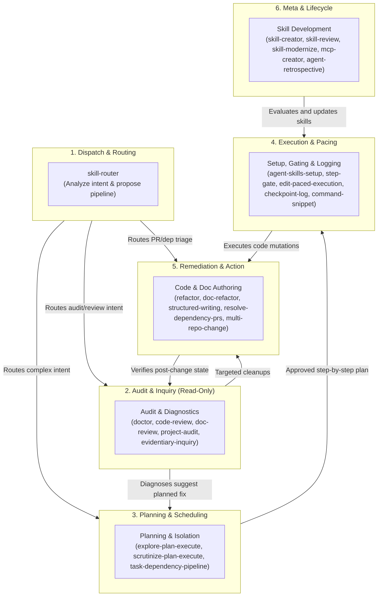
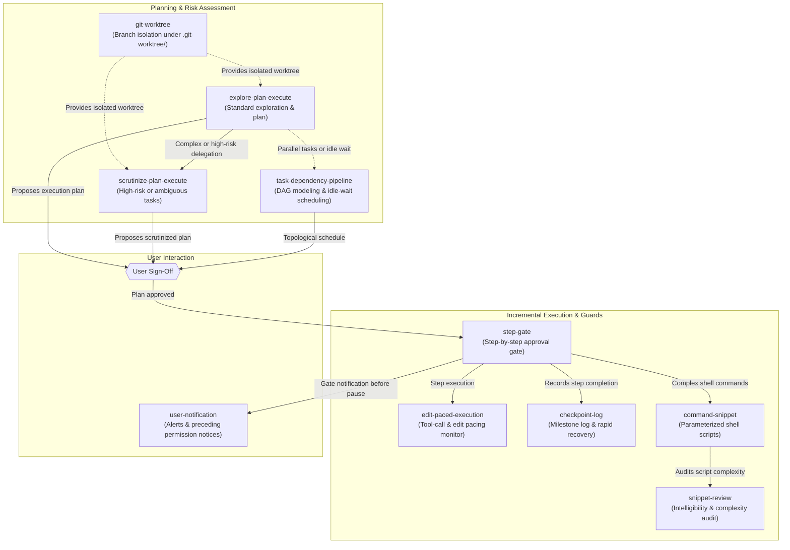
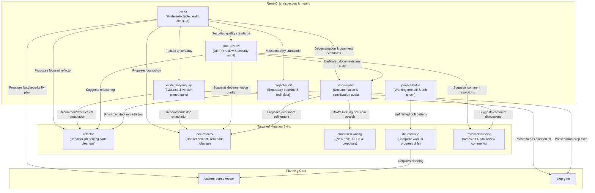
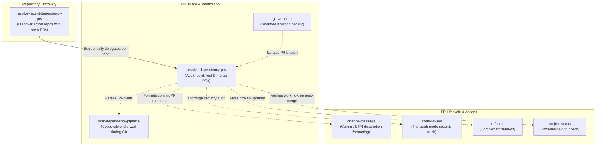
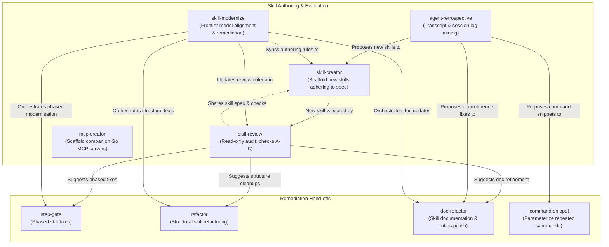

# Skill Interoperability & Workflow Architecture

This document details the modular interoperability, sequential hand-off patterns, and domain-specific workflow diagrams for skills across this repository.

Skills adhere to a **loosely coupled, sequential hand-off architecture**. Skills operate independently without rigid subroutine nesting; instead, they output actionable artifacts and suggest the next logical skill for explicit user approval.

---

## 1. High-Level Category Architecture

The agent skills ecosystem is organized into six functional domains:

---

## 2. Planning & Step-Gated Execution Workflow

This workflow governs non-trivial tasks requiring structured investigation, plan scrutiny, incremental execution, and defensive pacing.

---

## 3. Audit, Diagnostics & Remediation Workflow

This workflow handles read-only health evaluations, factual inquiries, and code reviews, handing off cleanly to mutation skills only when fixes are needed.

---

## 4. Multi-Repository & Dependency PR Triage Workflow

This workflow orchestrates dependency update audits, CI log matching, and automated PR merging across single or multiple repositories.

---

## 5. Skill Meta & Modernization Lifecycle

This workflow governs the creation, review, and evolution of agent skills to align with new model capabilities and harness conventions.

---

## 6. Interoperability Principles

1. **Intent-Driven Dispatch & Pipeline Routing**: `skill-router` acts as a read-only entrypoint dispatcher to analyze context, map user intent, and present an explicit sequential pipeline for user sign-off before executing any skill.
2. **Read-Only vs. Mutation Separation**: Audit and investigation skills (`project-audit`, `project-status`, `code-review`, `doc-review`, `skill-review`, `evidentiary-inquiry`, `doctor`, `snippet-review`, `skill-router`, `agent-retrospective`) are strictly read-only and never mutate files. When changes are required, they suggest mutation skills (`refactor`, `doc-refactor`, `step-gate`, `diff-continue`).
3. **Sequential Hand-off (User-in-the-Loop)**: Rather than calling other skills directly in a deep nested chain, skills present findings and recommend the next skill for the user to approve.
4. **Reference Sharing over Duplication**: When audit standards overlap (such as security and public release checklists), skills share references (e.g. `../code-review/references/security-checklist.md`) via relative links instead of duplicating checklist content.
5. **Gate Ownership**: When a skill's guidance or artifact is used inside another workflow, the calling workflow owns the approval gates; avoid introducing duplicate or redundant approval checkpoints.
