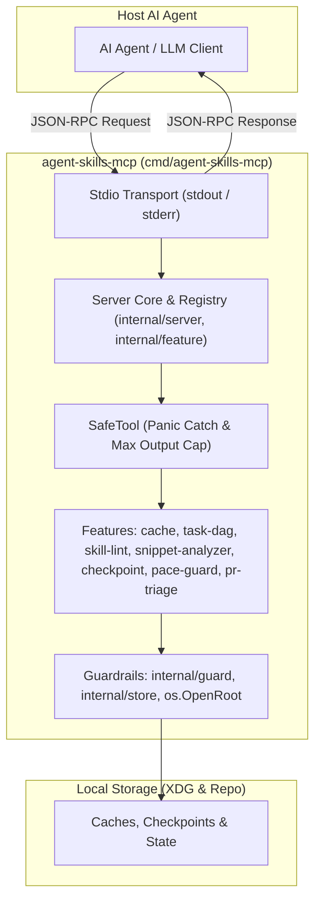

# MCP Server Guidelines (`mcp/AGENTS.md`)

Operational guidelines and architectural conventions for AI agents developing and maintaining the `agent-skills-mcp` Go module (`github.com/berquerant/agent-skills/mcp`).

---

## 1. Module Scope & Architecture

- **Standalone Single-Binary Module**:
  The MCP server is implemented as an independent Go module under `mcp/` (`go 1.27.4`). The compiled binary (`cmd/agent-skills-mcp`) exposes a standard MCP stdio server with CLI subcommands: `serve` (default), `version`, and `help`.
- **Architecture Reference**:
  For detailed multi-tier diagrams, component interactions, and lifecycle flows, see [references/architecture.md](references/architecture.md).
- **Stdio Transport Integrity**:
  `stdout` is strictly reserved for JSON-RPC MCP messages. All server logging, operational traces, and diagnostic messages must go to `stderr` (e.g. via `env.Logger` in `internal/feature`). Never write arbitrary text to `stdout`.
- **Offline-Only Operation (Zero Network Dependencies)**:
  The MCP server is purely local and offline. It must never make autonomous HTTP/HTTPS or network calls. Remote fetching, repository querying, and platform mutations are delegated to host CLI tools (`gh`, `glab`) and cached via `cache_*` tools.
- **Panic Recovery & Safe Tool Dispatch**:
  All MCP tool handlers must be registered using `feature.AddSafeTool` or `feature.AddSafeToolWithMax` (`internal/feature/safetool.go`), which automatically catches panics, enforces output size limits, and logs tool invocations.

---

## 2. Table-Driven Design & Catalog Separation

- **Table-Driven Everything**:
  All unit tests, integration tests, and classification rules must follow declarative, table-driven patterns (`tests := []struct{ ... }`). Tests must systematically cover boundary conditions, edge cases, error cases, and happy paths.
- **Catalog & Rule Decoupling**:
  Never embed ad-hoc procedural `if-else` chains or inline regexes for matching ecosystems, tools, or file types into execution logic. Isolate all patterns, file extensions, tool names, and bot identities into declarative catalog tables (e.g. `catalog.go`):
  - Ecosystem manifests and lockfiles (`manifestRules`)
  - Source code extensions across programming languages (`sourceCodeExtensions`)
  - Build, task, container, and linter configurations (`buildConfigBasenames`)
  - Test file and directory patterns (`testDirMarkers`, `isTestFile`)
  - Automated dependency bot authors, labels, and title conventions
- **Deterministic Evaluation**:
  All directory inspections, script extractions, and rule matching must produce deterministic, sorted outputs (e.g. using `slices.Sort`) to prevent non-deterministic diffs or tool responses.

---

## 3. Robust Security Boundaries over Half-Baked Measures

- **No Superficial or Illusionary Defenses**:
  Do not introduce half-baked, superficial security measures—such as naive string replacements, brittle ad-hoc substring blacklists, or simulated sandbox checks that create a false sense of security while breaking legitimate user inputs. Either enforce a strict, verifiable boundary or leave execution to explicit user confirmation.
- **OS-Enforced Containment (`os.OpenRoot`)**:
  When reading, writing, or inspecting files within a target directory (e.g. `CacheDir`, `StateDir`, or `repoDir` in task detection), always use Go's `os.OpenRoot` (`*os.Root`) to guarantee directory containment and prevent directory traversal or symlink escapes.
- **Shared Strict Guarding (`internal/guard`)**:
  All MCP tools must consistently validate file paths and text inputs using the shared guard package:
  - `guard.CheckPathAllowed`: Rejects access to sensitive system and user directories (e.g. SSH keys, cloud credentials, shell histories, system roots, certificates).
  - `guard.CheckNoSecrets`: Rejects high-entropy API tokens, private keys, and credential headers before writing state or logs.
- **Safe Persistence & Memory Caps**:
  All file persistence operations must use atomic file writes (`store.AtomicWriteFile`), temporary file cleanups, and cross-process file locks (`store.FileLock`). Decompression streams (such as zstd) must enforce maximum decoder memory limits to prevent compression bomb exploits.
- **No Real Names, Paths, or Configurations in Commits**:
  Never commit real personal or user names, host-specific absolute paths (e.g. user home directories), internal network hostnames/IPs, or actual environment configurations/credentials—even within test fixtures, code comments, usage examples, documentation, or mock data. Always use sanitized placeholders (`/path/to/...`, `<placeholder>`, `example.com`, `user`) and synthetic test fixtures.

---

## 4. Tripartite Consistency (MCP Tools, Skills, Fallbacks)

- **Strict Tripartite Alignment**:
  Every MCP tool, its corresponding agent skill under `skills/`, and the fallback documentation/scripts under `skills/*/references/` must always remain 100% consistent in behavior, naming, parameters, and terminology:
  | Feature | MCP Tools | Primary Skill | Manual Fallback Reference / Script |
  |---|---|---|---|
  | `cache` | `cache_get`, `cache_set`, `cache_exist`, `cache_delete`, `cache_purge`, `cache_version` | [`explore-plan-execute`](../skills/explore-plan-execute/SKILL.md) | [`command-cache-protocol.md`](../skills/explore-plan-execute/references/command-cache-protocol.md) |
  | `skill-lint` | `lint_skill`, `lint_all` | [`skill-review`](../skills/skill-review/SKILL.md) | [`automated-checks.md`](../skills/skill-review/references/automated-checks.md), [`run-checks.sh`](../skills/skill-review/scripts/run-checks.sh) (deprecated) |
  | `snippet-analyzer` | `snippet_audit` | [`snippet-review`](../skills/snippet-review/SKILL.md) | [`intelligibility-rubric.md`](../skills/snippet-review/references/intelligibility-rubric.md) |
  | `task-dag` | `dag_create`, `dag_next`, `dag_transition`, `dag_status`, `dag_render`, `dag_list`, `dag_delete` | [`task-dependency-pipeline`](../skills/task-dependency-pipeline/SKILL.md) | [`dag-scheduling-guide.md`](../skills/task-dependency-pipeline/references/dag-scheduling-guide.md) |
  | `checkpoint` | `checkpoint_init`, `checkpoint_append`, `checkpoint_resume`, `checkpoint_set_status`, `checkpoint_list` | [`checkpoint-log`](../skills/checkpoint-log/SKILL.md) | [`path-conventions.md`](../skills/checkpoint-log/references/path-conventions.md), [`log-format.md`](../skills/checkpoint-log/references/log-format.md) |
  | `pace-guard` | `pace_start`, `pace_tick`, `pace_status`, `pace_reset`, `pace_watch`, `pace_liveness` | [`edit-paced-execution`](../skills/edit-paced-execution/SKILL.md) | [`pace-monitoring-guide.md`](../skills/edit-paced-execution/references/pace-monitoring-guide.md) |
  | `pr-triage` | `pr_classify_files`, `pr_filter_candidates`, `pr_detect_tasks`, `pr_match_failure` | [`resolve-dependency-prs`](../skills/resolve-dependency-prs/SKILL.md) | [`filter-criteria.md`](../skills/resolve-dependency-prs/references/filter-criteria.md), [`ci-detection.md`](../skills/resolve-dependency-prs/references/ci-detection.md), [`failure-archetypes.md`](../skills/resolve-dependency-prs/references/failure-archetypes.md) |
- **Optional Dependency Principle**:
  Skills assume the MCP server is available by default for optimal performance, but must always provide explicit, functioning fallbacks to references or shell scripts when MCP is unavailable.
- **Synchronized Evolutions**:
  Whenever a tool's API or behavior changes (e.g. adding parameters, modifying outputs, or expanding rules), update the corresponding `SKILL.md` and reference documents in the same change set. Never allow documentation and tool implementations to drift.
- **Agent Discretion on Ambiguity (`unknown` Handling)**:
  When automatic heuristics cannot classify an input (`CategoryUnknown` or unrecognized signatures), the tool must report `unknown` explicitly and accept agent overrides/specifications (`overrides`, `allowed_pr_numbers`, `extra_*`), empowering the agent to resolve ambiguities safely without silent failures or forced guesses.

---

## 5. Code Quality & Complexity Constraints

- **File Length Limit**: Every `.go` file MUST NOT exceed **400 lines**. When a file grows near this limit, split it into cohesive, single-responsibility files (e.g. `models.go`, `catalog.go`, `classifier.go`).
- **Function Complexity Limits**:
  - Cyclomatic Complexity (CCN) must be **<= 15** per function.
  - Function length must be **<= 100 lines** (including test functions).
- **Prohibited Tool Mentions**:
  Never mention the names of external complexity or line-counting analysis commands (or their flags) in commit messages or code comments.
- **Verification Gate**:
  All changes must pass `mise run check` cleanly:
  - `mise run lint` (`shellcheck` and `shfmt`)
  - `mise run check-skills` (`bin/check-skills.sh`)
  - `mise run mcp:build` (`go build -o bin/agent-skills-mcp ./cmd/agent-skills-mcp`)
  - `mise run mcp:test` (`go test -cover -race ./...`)
  - `mise run mcp:vet` (`go vet ./...`)
  - `mise run mcp:fix` (`go fix -diff ./...`)
  - `mise run mcp:golangci-lint` (`golangci-lint run --no-config`)
  - `mise run mcp:readme-gen` / `mise run mcp:readme-diff` (regenerates and checks `mcp/README.md`)
