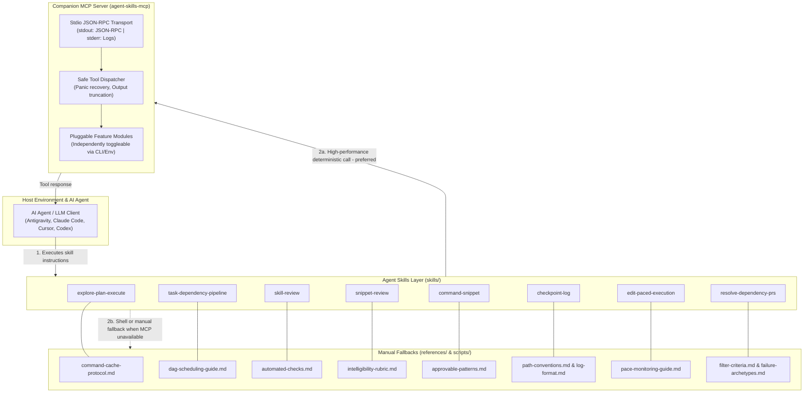
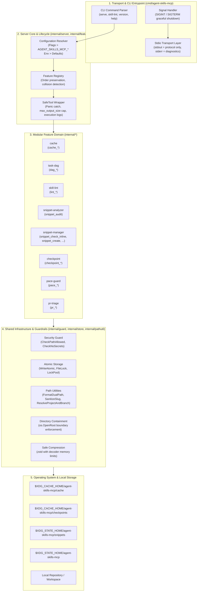
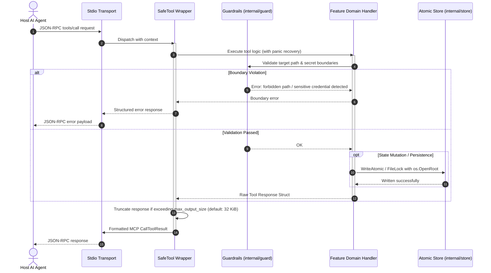
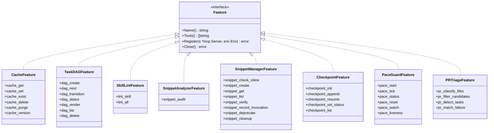

# agent-skills-mcp Architecture

This document details the architectural design, component layers, interaction protocols, and security guardrails of `agent-skills-mcp` (`github.com/berquerant/agent-skills/mcp`), the companion Model Context Protocol (MCP) server for `agent-skills`.

---

## 1. High-Level System Architecture & Tripartite Consistency

The repository maintains strict **Tripartite Consistency** across three operational tiers: high-level agent skills, deterministic Go MCP tools, and offline manual fallback specifications.

### Tripartite Operational Principles
1. **Primary Route**: When `agent-skills-mcp` is running, skills call deterministic Go MCP tools for microsecond execution, automated safety bounds, and atomic state tracking.
2. **Fallback Route**: If the MCP server is not configured in the host environment, skills follow explicit, step-by-step instructions or scripts under `skills/*/references/`.
3. **Behavioral Equivalence**: MCP tools, skills, and fallback references share identical data models, validation rubrics, and transition rules. Changes to one tier must be synchronized across all three tiers.

---

## 2. Internal Layered Architecture

`agent-skills-mcp` is structured into five distinct, decoupled layers to guarantee transport integrity, crash resilience, and strict containment.

### Layer Responsibilities

| Layer | Go Packages | Primary Responsibilities |
|---|---|---|
| **1. Transport & CLI** | `cmd/agent-skills-mcp` | Parses CLI flags/subcommands, isolates `stdout` for JSON-RPC, routes logs to `stderr`, and coordinates graceful process shutdown. |
| **2. Server Core** | `internal/server`, `internal/feature` | Instantiates MCP server instance, validates storage directories, registers enabled capabilities, and wraps tool handlers in safety guards. |
| **3. Feature Domain** | `internal/cache`, `internal/taskdag`, `internal/skilllint`, `internal/snippet`, `internal/snippetmgr`, `internal/checkpoint`, `internal/pace`, `internal/prtriage` | Implements discrete domain logic without network calls. Each module exposes zero or more tools conforming to the `feature.Feature` interface. |
| **4. Guardrails & Store** | `internal/guard`, `internal/store`, `internal/pathutil` | Blocks access to forbidden system paths, prevents credential leaks, formats output paths per output-presentation, manages atomic file swaps, cross-process and in-process file locks, and directory root containment (`os.OpenRoot`). |
| **5. Storage** | Standard Library (`os`, `io`) | Local non-volatile state and caches adhering to XDG base directory specifications. |

---

## 3. Tool Invocation & Safe Execution Lifecycle

Every MCP tool invocation traverses a protected execution pipeline that intercepts panics, enforces memory/output limits, and guards against unauthorized system access.

---

## 4. Feature Capabilities & Tool Mapping

All capabilities can be toggled via `--<feature-name>=true|false` or `AGENT_SKILLS_MCP_<FEATURE_NAME>=true|false`.

### Module Summary

| Feature Name | Tools Registered | Primary Purpose | Associated Skill |
|---|---|---|---|
| `cache` | `cache_get`, `cache_set`, `cache_exist`, `cache_delete`, `cache_purge`, `cache_version` | High-efficiency local key-value caching with zstd compression and TTL evictions. | [`explore-plan-execute`](../../skills/explore-plan-execute/SKILL.md) |
| `task-dag` | `dag_create`, `dag_next`, `dag_transition`, `dag_status`, `dag_render`, `dag_list`, `dag_delete` | Directed Acyclic Graph state tracking, topological scheduling, and Mermaid rendering. | [`task-dependency-pipeline`](../../skills/task-dependency-pipeline/SKILL.md) |
| `skill-lint` | `lint_skill`, `lint_all` | Automated Agent Skills Specification conformance checks (checks A through K). | [`skill-review`](../../skills/skill-review/SKILL.md) |
| `snippet-analyzer` | `snippet_audit` | Structural Python/Shell AST inspection and cognitive complexity scoring. | [`snippet-review`](../../skills/snippet-review/SKILL.md) |
| `snippet-manager` | `snippet_check_inline`, `snippet_create`, `snippet_get`, `snippet_list`, `snippet_verify`, `snippet_record_invocation`, `snippet_deprecate`, `snippet_cleanup` | Inline-command extraction check, immutable versioned snippet storage (`0500`), SHA-256 and inode verification, invocation logging, and lifecycle cleanup under XDG state. | [`command-snippet`](../../skills/command-snippet/SKILL.md) |
| `checkpoint` | `checkpoint_init`, `checkpoint_append`, `checkpoint_resume`, `checkpoint_set_status`, `checkpoint_list` | Structured task milestone logging, state resumption, and step verification. | [`checkpoint-log`](../../skills/checkpoint-log/SKILL.md) |
| `pace-guard` | `pace_start`, `pace_tick`, `pace_status`, `pace_reset`, `pace_watch`, `pace_liveness` | Pacing threshold tracker to prevent non-edit tool loops and silent agent stalls. | [`edit-paced-execution`](../../skills/edit-paced-execution/SKILL.md) |
| `pr-triage` | `pr_classify_files`, `pr_filter_candidates`, `pr_detect_tasks`, `pr_match_failure` | Dependency PR classification, task detection, and CI failure archetype matching. | [`resolve-dependency-prs`](../../skills/resolve-dependency-prs/SKILL.md) |

---

## 5. Security & Isolation Guardrails

`agent-skills-mcp` is designed with defense-in-depth principles to protect host environments and agent workflows:

1. **Strict Stdio Separation**:
   - `stdout` is strictly reserved for valid JSON-RPC protocol frames.
   - All server diagnostics, startup messages, and debug traces are directed to `stderr` or an explicit `--log-file`. Any stray writes to `stdout` are treated as protocol corruption bugs.
2. **Offline-Only Operation (Zero Network Access)**:
   - The binary executes entirely locally with zero outbound HTTP/HTTPS network dependencies.
   - Remote queries (e.g., GitHub PRs, external status) must be performed by host CLI tools (`gh`, `glab`) and passed as inputs to MCP tools.
3. **Directory Root Containment (`os.OpenRoot`)**:
   - Filesystem inspections and file extractions within workspaces or state directories use Go's `os.OpenRoot` (`*os.Root`) to prevent directory traversal attacks and symlink escapes.
4. **Credential & Secret Protection (`internal/guard`)**:
   - All path, key, and secret detection rules are maintained declaratively in `mcp/internal/guard/rules.json` (embedded via `//go:embed`). See [`security-rules.md`](security-rules.md) for rule inclusion criteria and continuous improvement procedures.
   - `guard.CheckPathAllowed`: Denies inspection or writes targeting sensitive paths (e.g., `~/.ssh`, `~/.aws`, `~/.gnupg`, `~/.config/gh/hosts.yml`, `/etc`).
   - `guard.CheckNoSecrets`: Scans payloads for high-entropy tokens, private keys, and authorization headers to prevent accidental leakage into persistent state files.
   - **No Real Identifiers or Configurations in Commits**: Real personal names, host-specific paths (e.g. user home directories), and actual environment configurations must never be committed even as examples or test fixtures; synthetic mock data and generic placeholders (`<placeholder>`, `/path/to/...`, `example.com`) are mandatory.
5. **Atomic File Operations & Process Concurrency (`internal/store`)**:
   - All state modifications are performed via `store.WriteAtomic` (write to temporary sibling file followed by atomic rename).
   - Cross-process file locks (`store.FileLock` / `store.LockPool`) prevent race conditions between concurrent agent runs.
6. **Compression Bomb Defense**:
   - Cached payloads compressed via zstd enforce strict maximum decoder memory allocation limits during decompression to mitigate decompression-bomb resource exhaustion.
