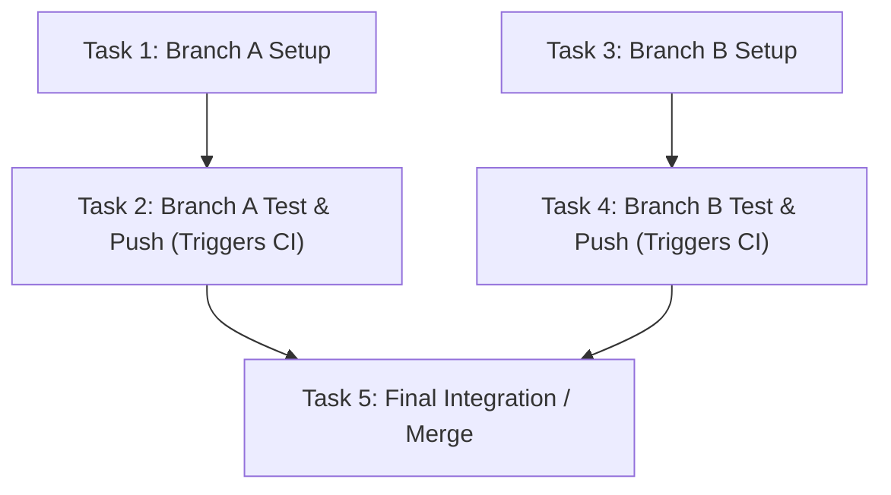

# Task Dependency Pipeline

Decomposes complex goals into a Directed Acyclic Graph (DAG) of interdependent tasks and executes them using a cooperative idle-wait scheduler. By identifying independent task branches, this skill enables progressive execution—switching context to advance ready tasks whenever an active task enters an idle wait state.

---

## Prerequisites

- Clearly understood goal, requirements, or multi-step plan (e.g., from `explore-plan-execute` or `scrutinize-plan-execute`).
- Execution scope spans multiple tasks, repositories, branches, or steps where some operations involve waiting (remote CI, long builds, cooldowns, approval checkpoints).
- For conceptual background, state machine definitions, and scheduler loop details, refer to [references/dag-scheduling-guide.md](references/dag-scheduling-guide.md).

---

## Step 1: Decompose Goals into a Task Dependency Graph (DAG)

Break the overall objective down into discrete tasks, mapping explicit dependencies and execution resources.

1. **Identify Tasks**:
   Assign each task a unique ID (e.g., `task-backend-build`, `task-frontend-lint`, `task-integration-test`).
2. **Specify Upstream Dependencies (`depends_on`)**:
   Explicitly declare which tasks must complete before a given task can start.
3. **Identify Independent Branches**:
   Locate tasks that have no direct or transitive dependency on each other. These branches can run concurrently or be interleaved during wait states.
4. **Identify Wait Profiles**:
   Flag tasks that encounter external or asynchronous delays (e.g., remote CI runs, build artifact generation, human approval gates).
5. **Enforce Isolation Scopes**:
   Ensure independent tasks that modify code or files operate in isolated working directories or dedicated git worktrees.



Verify:
- The graph is strictly acyclic (no circular dependencies).
- Every task has an explicit list of dependencies (or empty list if ready immediately).
- File/branch modification targets do not conflict across concurrently active tasks.

---

## Step 2: Formulate the Interleaved Pipeline Plan

Synthesize the DAG into an actionable pipeline plan detailing execution phases, interleaving opportunities, and verification checkpoints.

1. **State Machine Mapping**:
   Map each task to its initial state (`READY` for root tasks, `BLOCKED` for dependent tasks).
2. **Context Switching Strategy**:
   Define what independent task will be executed when an active task transitions to `WAITING` (e.g., while Task 2 waits for remote CI, switch to Task 3).
3. **Check Frequency and Anti-Polling Rules**:
   Define minimum delay intervals before re-evaluating `WAITING` tasks to prevent wasteful polling or rate-limit exhaustion.
4. **Failure & Rollback Boundaries**:
   Identify which downstream tasks halt if an upstream task fails, and confirm that unaffected independent branches can safely continue.

Verify:
- The pipeline plan clearly specifies the order in which `READY` tasks are picked.
- Context switch trigger points and resumption conditions are documented for every task with an asynchronous wait profile.

---

## Step 3: Present Plan and Secure User Approval (Gate)

Present the DAG structure, task definitions, and interleaving strategy to the user for sign-off.

```markdown
### Task Dependency Pipeline Plan

#### 1. Dependency Graph
- `task-1`: Setup Repo A (no dependencies) -> Target: worktree A
- `task-2`: Run CI Repo A (depends on `task-1`) -> Wait Profile: Asynchronous CI (~3-5m)
- `task-3`: Setup Repo B (no dependencies, independent of `task-1`) -> Target: worktree B
- `task-4`: Run CI Repo B (depends on `task-3`) -> Wait Profile: Asynchronous CI (~3-5m)
- `task-5`: Aggregated Verification (depends on `task-2`, `task-4`)

#### 2. Cooperative Interleaving Strategy
- Start `task-1`. Upon completion, start `task-2`.
- When `task-2` triggers CI and enters `WAITING`, immediately switch context to `task-3` instead of idling.
- When `task-3` finishes, trigger `task-4`.
- Check `task-2` CI status at scheduled checkpoint.

Do you approve this pipeline execution plan?
```

Verify:
- The user explicitly approves the pipeline plan and interleaving strategy before execution commences.
- Any requested adjustments to task boundaries or dependencies are incorporated.

---

## Step 4: Execute via Cooperative Scheduler Loop

Execute tasks following the cooperative scheduling algorithm:

1. **Evaluate Tasks**:
   - Promote `BLOCKED` tasks to `READY` as their dependencies reach `COMPLETED`.
   - Pick the next `READY` task (prioritizing critical-path unblockers and local work).
2. **Execute Active Task**:
   - Transition task to `RUNNING` and perform operations.
   - If execution completes successfully, mark `COMPLETED` and evaluate downstream tasks.
   - If a long-running external process or wait state begins, record checkpoint condition, mark `WAITING`, and yield context.
   - If execution fails or an unrecoverable error occurs, mark `HALTED` and pause downstream dependents.
3. **Handle Idle Wait Context Switches**:
   - When active task enters `WAITING`, immediately inspect queue for other `READY` tasks.
   - If another `READY` task exists, switch context and execute it.
   - If all active tasks are `WAITING`, perform a single targeted check on the oldest waiting task after the appropriate delay interval. Never enter a tight polling loop.
4. **Log Progress**:
   Record task state transitions, context switches, and milestones (e.g., using `checkpoint-log`).

Verify:
- All tasks in the DAG reach `COMPLETED` or explicitly `HALTED` with user consultation.
- No two tasks operating in the same working tree or modifying shared resources run concurrently.
- No tight polling loops were executed while waiting for external processes.

---

## Guidelines

- **No Premature Execution**: Always obtain explicit user approval on the DAG and interleaving plan before beginning task execution.
- **Strict Isolation**: When tasks involve file changes or branch checkouts, enforce physical isolation via separate worktrees or independent paths.
- **Anti-Polling Principle**: Never query remote APIs or external processes repeatedly in rapid succession. Use single-shot checks with reasonable backoff intervals.
- **Subtree Halting**: A failure in one branch only halts its downstream dependents; allow independent branches to proceed unless the failure impacts shared global state.
- **Cooperative Hand-off**: Cooperate cleanly with specialized execution skills—hand off step-by-step single-task execution to `step-gate`, worktree creation to worktree isolation tools, and commit messages to `change-message`.
