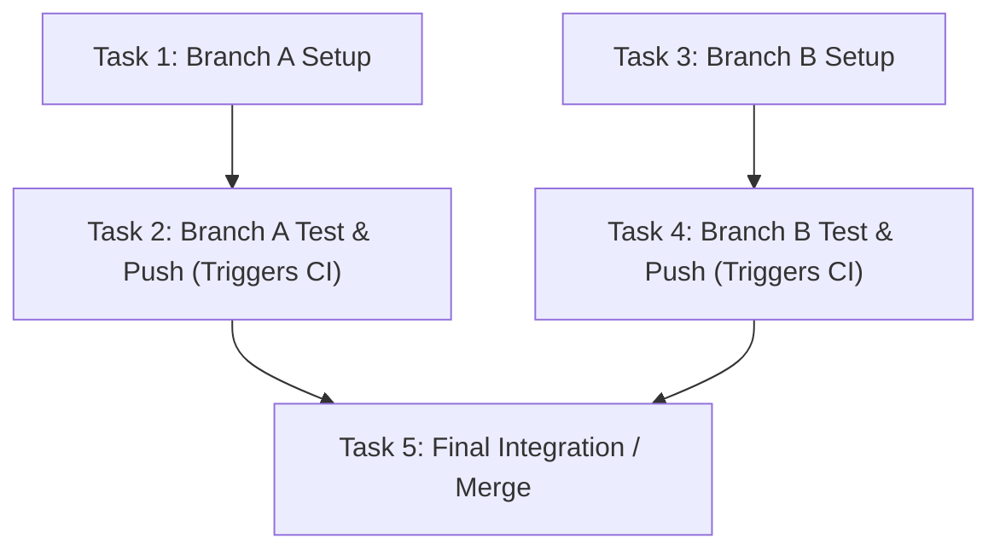

# Task Dependency Pipeline

Decomposes complex goals into a Directed Acyclic Graph (DAG) of interdependent tasks and executes them using a cooperative idle-wait scheduler. By identifying independent task branches, this skill enables progressive execution—switching context to advance ready tasks whenever an active task enters an idle wait state.

---

## Prerequisites

- Clearly understood goal, requirements, or multi-step plan (e.g., from [explore-plan-execute](../explore-plan-execute/SKILL.md) (../explore-plan-execute/SKILL.md) or [scrutinize-plan-execute](../scrutinize-plan-execute/SKILL.md) (../scrutinize-plan-execute/SKILL.md)).
- Execution scope spans multiple tasks, repositories, branches, or steps where some operations involve waiting (remote CI, long builds, cooldowns, approval checkpoints).
- Access to the companion MCP server (`agent-skills-mcp`) providing the `task-dag` toolset (`dag_create`, `dag_next`, `dag_transition`, `dag_status`, `dag_render`). If the MCP server is unavailable, refer to [dag-scheduling-guide.md](references/dag-scheduling-guide.md) (references/dag-scheduling-guide.md) for manual state machine tracking, topological ordering, and scheduler loop details.

---

## Step 1: Decompose Goals into a Task Dependency Graph (DAG)

Break the overall objective down into discrete tasks, mapping explicit dependencies and execution resources.

1. **Identify Tasks**:
   Assign each task a unique ID (e.g., `task-backend-build`, `task-frontend-lint`, `task-integration-test`).
2. **Specify Upstream Dependencies (`depends_on`)**:
   Explicitly declare which tasks must complete before a given task can start.
3. **Identify Independent Branches**:
   Locate tasks that have no direct or transitive dependency on each other. These branches can run concurrently or be interleaved during wait states.
4. **Identify Wait Profiles**:
   Flag tasks that encounter external or asynchronous delays (e.g., remote CI runs, build artifact generation, human approval gates).
5. **Enforce Isolation Scopes**:
   Ensure independent tasks that modify code or files operate in isolated working directories or dedicated git worktrees.



Verify:
- The graph is strictly acyclic (no circular dependencies).
- Every task has an explicit list of dependencies (or empty list if ready immediately).
- File/branch modification targets do not conflict across concurrently active tasks.

---

## Step 2: Formulate the Interleaved Pipeline Plan

Synthesize the DAG into an actionable pipeline plan detailing execution phases, interleaving opportunities, and verification checkpoints.

1. **State Machine Mapping**:
   Map each task to its initial state (`READY` for root tasks, `BLOCKED` for dependent tasks).
2. **Context Switching Strategy**:
   Define what independent task will be executed when an active task transitions to `WAITING` (e.g., while Task 2 waits for remote CI, switch to Task 3).
3. **Check Frequency and Anti-Polling Rules**:
   Define minimum delay intervals before re-evaluating `WAITING` tasks to prevent wasteful polling or rate-limit exhaustion.
4. **Failure & Rollback Boundaries**:
   Identify which downstream tasks halt if an upstream task fails, and confirm that unaffected independent branches can safely continue.

Verify:
- The pipeline plan clearly specifies the order in which `READY` tasks are picked.
- Context switch trigger points and resumption conditions are documented for every task with an asynchronous wait profile.

---

## Step 3: Present Plan and Secure User Approval (Gate)

Present the DAG structure, task definitions, and interleaving strategy to the user for sign-off.

```markdown
### Task Dependency Pipeline Plan

#### 1. Dependency Graph
- `task-1`: Setup Repo A (no dependencies) -> Target: worktree A
- `task-2`: Run CI Repo A (depends on `task-1`) -> Wait Profile: Asynchronous CI (~3-5m)
- `task-3`: Setup Repo B (no dependencies, independent of `task-1`) -> Target: worktree B
- `task-4`: Run CI Repo B (depends on `task-3`) -> Wait Profile: Asynchronous CI (~3-5m)
- `task-5`: Aggregated Verification (depends on `task-2`, `task-4`)

#### 2. Cooperative Interleaving Strategy
- Start `task-1`. Upon completion, start `task-2`.
- When `task-2` triggers CI and enters `WAITING`, immediately switch context to `task-3` instead of idling.
- When `task-3` finishes, trigger `task-4`.
- Check `task-2` CI status at scheduled checkpoint.

Do you approve this pipeline execution plan?
```

Verify:
- The user explicitly approves the pipeline plan and interleaving strategy before execution commences.
- Any requested adjustments to task boundaries or dependencies are incorporated.

---

## Step 4: Execute via Cooperative Scheduler Loop

Execute tasks using the cooperative scheduler loop:

1. **Initialize and Query**: Create the graph via `dag_create` with the approved tasks and dependencies, then call `dag_next` to pick the highest-priority unblocked task.
2. **Execute and Transition**: Transition the active task to `RUNNING` via `dag_transition`, execute operations, and transition to `COMPLETED` on success or `HALTED` on failure.
3. **Handle Idle Waits**: When an external delay starts, transition the task to `WAITING` with `poll_after_sec`. Immediately invoke `dag_next` to switch context to an independent `READY` task. The server enforces anti-polling cooldowns deterministically.
4. **Inspect and Render**: Call `dag_status` or `dag_render` to verify progress, critical paths, and unblocked tasks.

If the MCP server is unavailable, follow the manual scheduler loop in [dag-scheduling-guide.md](references/dag-scheduling-guide.md) (references/dag-scheduling-guide.md):
- **Evaluate Tasks**: Promote `BLOCKED` tasks to `READY` as dependencies reach `COMPLETED`; pick the next unblocker.
- **Execute Active Task**: Mark `RUNNING`, perform work, and mark `COMPLETED`, `WAITING`, or `HALTED`.
- **Handle Context Switches**: When waiting, switch immediately to another `READY` task without tight polling loops.
- **Log Progress**: Record task transitions and milestones (e.g. via [checkpoint-log](../checkpoint-log/SKILL.md) (../checkpoint-log/SKILL.md)).

Verify:
- All tasks in the DAG reach `COMPLETED` or explicitly `HALTED` with user consultation.
- No two tasks operating in the same working tree or modifying shared resources run concurrently.
- No tight polling loops were executed while waiting for external processes.

---

## Guidelines

- **Secure approval on the DAG before execution**: Present the dependency graph and interleaving strategy for user sign-off in Step 3 so task boundaries and wait transitions are agreed up front.
- **Enforce physical workspace isolation**: Run concurrent or interleaved tasks that modify files in separate worktrees or directories to prevent working-tree collisions.
- **Use single-shot status checks over polling**: Switch immediately to another `READY` task when an active task enters `WAITING`, and re-check external processes only at scheduled intervals to avoid API rate-limit exhaustion.
- **Halt only dependent subtrees on failure**: Pause downstream dependents when an upstream task fails while allowing independent branches to continue unless shared global state is affected.
- **Coordinate with companion execution skills**: Hand off step-by-step execution to [step-gate](../step-gate/SKILL.md) (../step-gate/SKILL.md), worktree setup to [git-worktree](../git-worktree/SKILL.md) (../git-worktree/SKILL.md), and commit messages to [change-message](../change-message/SKILL.md) (../change-message/SKILL.md).
