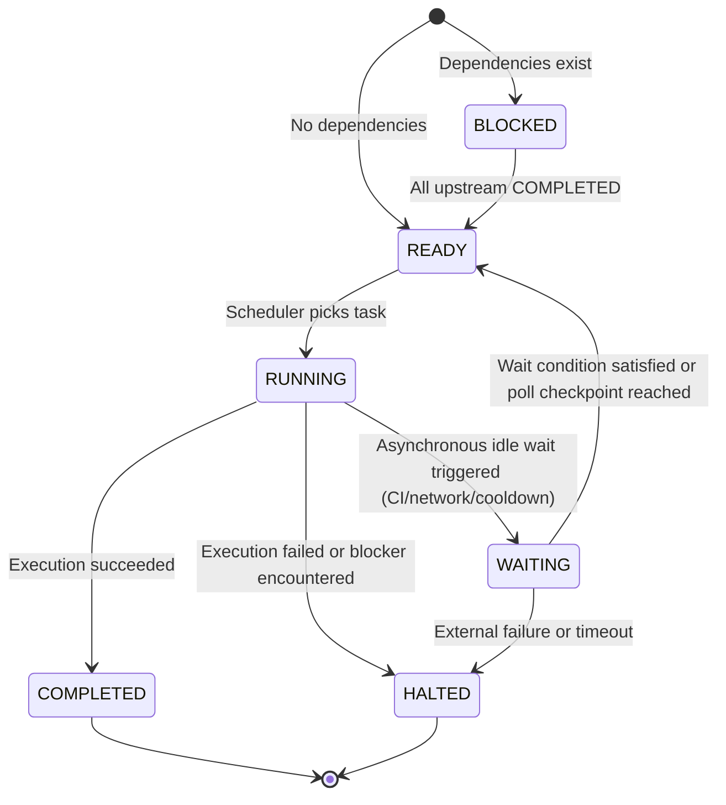
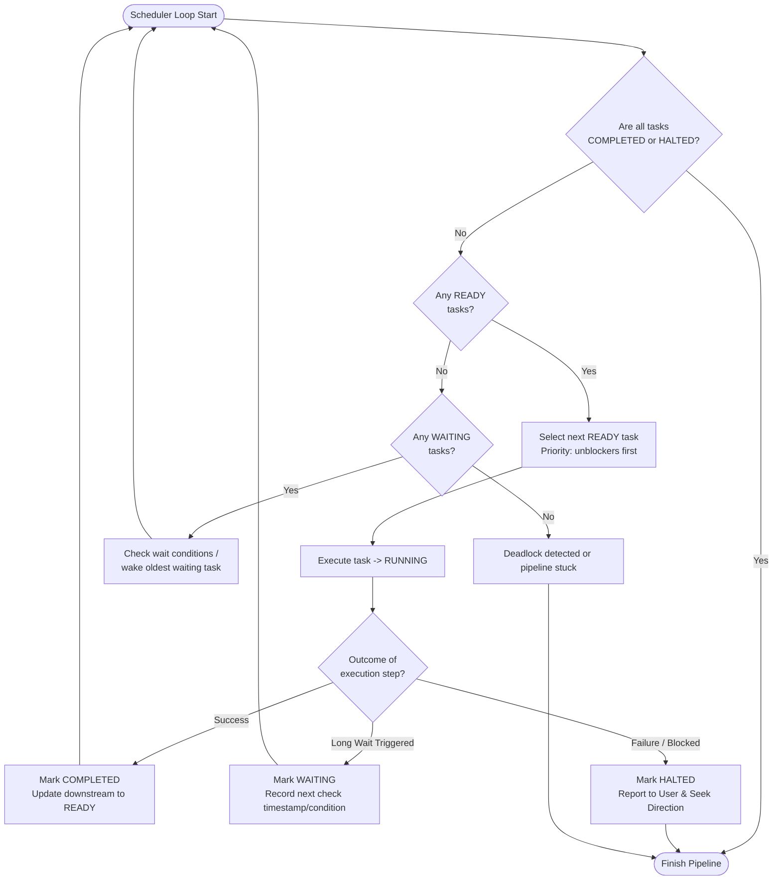

# DAG Modeling & Cooperative Scheduling Guide

This reference provides foundational concepts, lifecycle states, scheduling algorithms, and concurrency isolation patterns for modeling and executing tasks as a Directed Acyclic Graph (DAG) with cooperative idle-wait interleaving.

---

## 1. Directed Acyclic Graph (DAG) Modeling

When breaking down complex projects or workflows, individual tasks rarely form a strictly linear chain. Many tasks can proceed independently, while others depend strictly on upstream outputs.

```
       ┌─ Task A (Setup / Branch 1) ─► Task C (Build / Test 1) ─┐
Root ──┤                                                        ├─► Task E (Integration / Report)
       └─ Task B (Setup / Branch 2) ─► Task D (Build / Test 2) ─┘
```

### 1.1 Node Properties
Every task node in a dependency graph must define:
- **Task ID**: Unique alphanumeric identifier (e.g., `task-backend-build`, `task-frontend-lint`).
- **Dependencies (`depends_on`)**: List of upstream Task IDs that must reach `COMPLETED` before this task can become `READY`.
- **Execution Target / Resource**: File paths, worktree path, or environment scope to prevent concurrent write collisions.
- **Estimated Wait Profile**: Whether the task involves synchronous local execution or asynchronous external waiting (e.g., CI jobs, network downloads, human review gates, rate-limit backoffs).

### 1.2 Edge Validation
- **No Cycles**: The dependency graph must be strictly acyclic. Validate topological sortability before execution.
- **Independence Identification**: Any nodes $T_i$ and $T_j$ with no direct or transitive path between them ($T_i \not\to^* T_j$ and $T_j \not\to^* T_i$) are independent and can be executed concurrently or cooperatively interleaved.

---

## 2. Task Lifecycle State Machine

Each task in the DAG transitions through the following formal states:



### State Definitions
1. **`BLOCKED`**: The task has one or more upstream dependencies in states other than `COMPLETED`.
2. **`READY`**: All upstream dependencies have reached `COMPLETED`. The task is queued and ready to be picked up.
3. **`RUNNING`**: The agent is actively executing commands, reading files, or applying edits for this task.
4. **`WAITING`**: The task is temporarily suspended awaiting an external, asynchronous, or rate-limited event (e.g., remote CI completion, user review checkpoint, cooldown timer). The active agent context is yielded.
5. **`COMPLETED`**: The task has successfully passed all verification criteria. Downstream dependents evaluate their readiness.
6. **`HALTED`**: The task encountered a failure, test breakage, or unresolvable blocker. The scheduler pauses dependent tasks and seeks user direction.

---

## 3. Cooperative Idle-Wait Scheduler Loop

In an AI agent workflow, multiple tasks cannot always run in parallel shell threads without colliding on workspace state or overwhelming agent context. The **Cooperative Scheduler Loop** switches context whenever a running task transitions to `WAITING`, progressing independent `READY` tasks rather than idling.

### 3.1 Scheduling Algorithm



### 3.2 Selection & Priority Rules
When multiple tasks are in the `READY` state, prioritize by:
1. **Critical Path Unblockers**: Tasks whose completion unblocks the highest number of downstream tasks.
2. **Local Work over Remote Checks**: Prefer executing local commands or code edits over polling external status.
3. **Short / Low-Cost Tasks**: Complete quick validations or setups to clear queues quickly.

### 3.3 Anti-Polling and Backoff Guidelines
- **No Tight Busy-Loops**: When checking `WAITING` tasks, never query external APIs or remote Git remotes in a tight loop.
- **Enforce Checkpoint Intervals**: Respect minimum delay intervals (e.g., 30–60 seconds for CI runs, external API rate-limit delays) before re-checking external states.
- **Single-Shot Verification**: When awakening a `WAITING` task, perform a single targeted status query. If not yet done, return it to `WAITING` and pick another `READY` task.

---

## 4. Resource Isolation & Concurrency Safety

When switching between independent tasks, resource collisions must be strictly prevented:

### 4.1 Worktree Isolation
- Tasks operating on different Git branches or modifying repository files **must** execute in isolated Git worktrees (e.g., standard `git worktree` isolation).
- Never allow interleaved file editing in the same working tree across independent tasks.

### 4.2 Shared State & Mutexes
- **API Token Quotas**: Coordinate external platform or API requests across tasks to respect global rate limits.
- **Log Files**: Tasks logging to milestone or checkpoint logs must serialize log writes or write to distinct task-specific log sections.
- **Artifact Isolation**: Each independent task stream should store temporary test outputs and scratch snippets in task-prefixed paths.

---

## 5. Recovery & Rollback

- **Subtree Halting**: If a task reaches `HALTED`, only its downstream descendants are blocked. Other independent branches in the DAG may continue executing unless the failure invalidates global assumptions.
- **Checkpoint Resilience**: Maintain task state transitions in a persistent checkpoint log so an interrupted pipeline can resume without re-running `COMPLETED` tasks.
